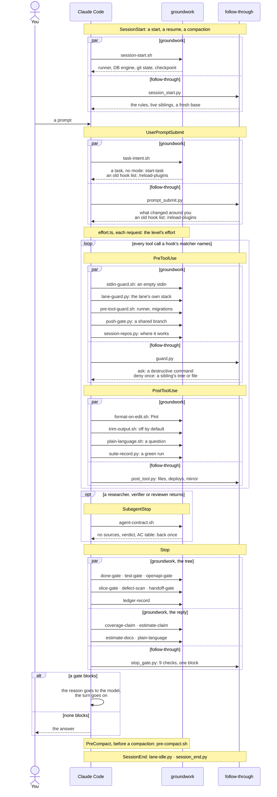
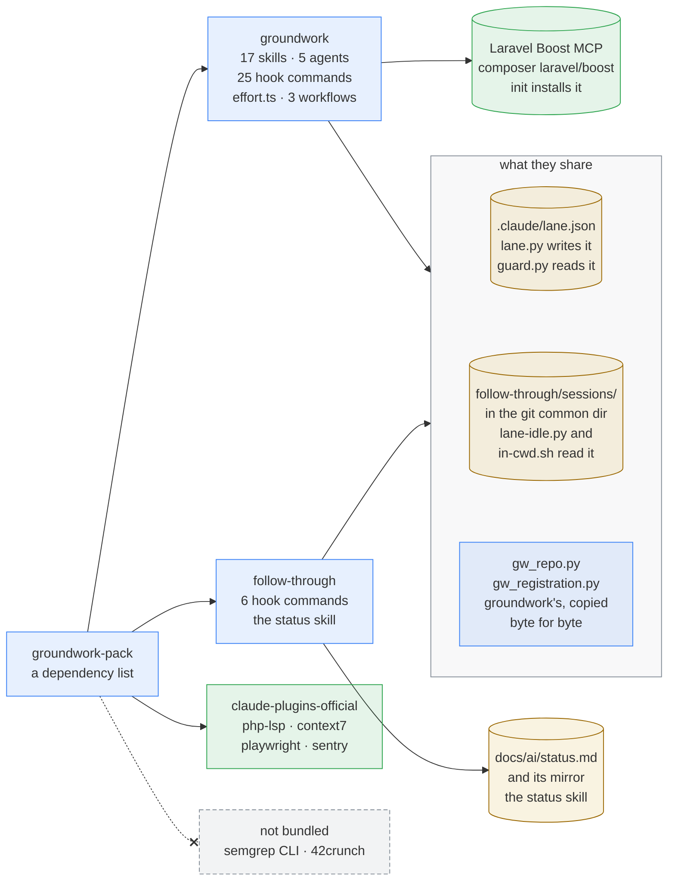

# Groundwork

[](https://github.com/YasMax91/groundwork/actions/workflows/ci.yml)

A Claude Code plugin that makes an agent work a Laravel backend the way a senior engineer does:
find the blast radius before planning, agree on the plan before writing code, prove external-API
claims against cited docs instead of guessing, and refuse to call anything "done" until the gates —
format, static analysis, tests, OpenAPI — are green and the change has been exercised against the
running app.

The name is the method: *groundwork* is both the discovery and specification that come before the
first line of code, and the grounding protocol that makes the agent cite or verify a claim rather
than invent it.

One versioned source of process for every project, so repositories stay thin — domain facts in their
own `AGENTS.md`, nothing else copy-pasted between them.

Created and maintained by **Max Yastremskyi** ([YasMax91](https://github.com/YasMax91)). MIT.
Battle-tested day to day on production Laravel backends at RaDevs.

## In practice

Across **12 production codebases** as of October 2026: 800+ procedure runs, 300+ written specs, 90
auto-generated frontend hand-offs — and roughly **one task in three stopped before any code was
written**, because it was mis-scoped, conflicted with behaviour that already existed, or was
cheaper to solve without development at all.

That number is the point. An agent will happily write plausible code and just as happily report
that it is done; the cost is not the bad code, it is the code written against a task nobody
scoped. Groundwork makes the checking part of the process instead of an act of faith afterwards.

```
/plugin marketplace add YasMax91/groundwork
/plugin install groundwork@yasmax
/groundwork:init
```

Longer write-up, with the gates explained one by one:
**[yastremskyi.com/groundwork](https://yastremskyi.com/groundwork)**. Full install notes,
companion plugins and per-project configuration are further down this file.

## What's inside

- **Process (AI-SDD)** — skills: `start-task`, `spec`, `implement-approved`, `risk-review`,
  `final-check`, `estimate`, `init`. Discovery fans out via the `impact-mapper` agent (scaled by task level
  L0–L4) — the full blast radius before planning, so changes stay scoped without missing a consumer.
  Two review gates: `adversarial-verifier` (is the "it works" claim true?) and `conformance-reviewer`
  (does the diff satisfy the spec's acceptance criteria?). Each agent runs on the model its role needs —
  `conformance-reviewer`, `adversarial-verifier` and `blind-spot-mapper` on Opus, `grounded-researcher` on
  Sonnet, `impact-mapper` on the session's — at the effort the task's level sets (see *Models and effort*). A
  converge re-check and ADR capture (`docs/ai/adr/`) close out cross-cutting L3/L4 work.
- **Approaches before questions** — the first response shows the agent's 2–3 candidate ways to solve the
  task, recommended one first, with the reason and what it forecloses, *before* the interview — so you
  choose between shapes of a solution instead of ratifying one. When a single path is plainly right it
  says so in one line rather than inventing alternatives; at L3/L4 the same options feed the ADR. And when
  the intent is too unformed to plan at all — a problem rather than a change, or no statable definition of
  "done" — the unbounded interview is not just offered but **recommended**, instead of planning on top of a
  guess. Accept it and the agent runs that interview **right there**, without you typing the command. `/grill`
  stays the manual way in for stress-testing something that is not a task yet.
- **Blast radius that follows the task** — a new sub-request mid-session is treated as a scope change: its
  seeds are compared against the cached impact map, and a miss re-maps over the union of old and new seeds
  (a targeted self-trace at L0/L1). The cheap comparison runs at every level, because three small
  additions can jointly touch a class nobody mapped — the case where a map built at task start quietly
  stops covering the work.
- **Interview loop** — `clarify-protocol` + `AskUserQuestion` rounds before the plan: facts are the
  agent's to find, decisions are yours to make. Each question leads with the agent's recommendation, so
  you can click through and still land somewhere defensible; scaled by level (L0/L1 barely ask, L2 up to
  two rounds, L3/L4 up to four), and every answer is recorded so a compaction never re-asks it. Money,
  permissions, what the client sees, and external-integration behaviour carry a round of their own from
  L2 up however settled the request sounds, and at those levels the first round offers the unbounded interview
  as a choice — you pick the depth instead of learning later that you were not asked. Whatever the agent still
  decided for you is listed before the plan as the **cost of silence**: what was assumed, what it costs if
  wrong, and the one line that changes it. The `grill` skill runs the same interview standalone — to
  stress-test a plan, a decision, or an idea that never becomes code.
- **Plain language first** — every text you read in chat opens with the lived consequence in everyday
  words and keeps the code, field name, or status number after it: "клиент нажимает «Оплатить» и видит
  ошибку, деньги не списываются (внутренний код 2406)". A layer, not a simplification — nothing
  technical is deleted, it just stops being the opening. Three things come with it: a **brief** before
  any question (what the agent established itself, why this decision is yours, what changes under each
  answer), a closing **ask line** naming what you do now — «ничего, работаю дальше» included — and a
  table that keeps the plugin's own vocabulary out of chat, so "blast radius" arrives as «что ещё это
  заденет» and the task level never arrives as "L2" at all. Defined once in `plain-language`, held by
  a blocking Stop gate (one re-entry); documents written for developers stay engineering prose.
- **Client document** — the `client-doc` skill writes for a client who does not know what a test or an
  endpoint is: the problem, what he will be able to do, what is in and out of scope, what is needed from
  him. Deliberately without tests, acceptance criteria, endpoints, schema, or architecture — if those are
  wanted, the artifact is a `spec`, and the skill says so instead of producing a hybrid. Estimates are
  **the real wall-clock time the agent spends building it** — never man-days, and never a man-day
  relabelled as hours: work on existing mechanisms is minutes and is published as minutes. Everything
  that needs a person — provider accounts, API keys, decisions, review — is a separate line with its own
  owner, never added to the development number. Ships as
  an English canonical file (what you send) plus a full Russian mirror (what you read), regenerated from
  the English so the two cannot drift.
- **Estimates are measured, not felt** — the `estimate` skill answers "how long will this take?" from a
  ledger of **this machine's own agent time**. `estimate-ledger.sh` records the active minutes of every
  finished task (idle gaps excluded, so a session you walked away from is not counted as work) — written
  by a `Stop` hook the moment the checkpoint is closed with `Mode: Done`, once per task, rather than by
  the agent remembering a command — and
  backfills a seed corpus from git history in seconds; an estimate quotes the median and the sample size
  it rests on. The unit is the agent's active minutes, human time is always a separate line with its
  owner, and an hour-sized number has to name the slow thing beside it — an external API to establish,
  a sandbox probe, a migration over a large table. A blocking Stop gate (`gates.estimate_claim`)
  catches the ones that do not — in chat, and, through `estimate-docs.py`, in documents under `docs/`
  and texts for forwarding: no person-days, no "5 days" without a named wait, and a table total that
  equals the sum of its rows. Measured on this author's corpus, calendar span overstates active agent
  time by roughly 3×, which is why "how long did the last one take?" was never a safe substitute for
  measuring it.
- **Blind-spot surfacing** — the agent proactively raises what you did not think to ask: unintended
  consequences, missing requirements, and domain/product angles you are not the expert in — each with
  its consequence and a recommended default, in plain language. A `blind spots` block in the first
  response (distinct from clarify), the `blind-spot-mapper` agent in a fresh context for L3/L4, and
  touchpoints across spec, implementation, review, and frontend handoff. Calibrated against noise —
  material items only, "none" is honest. See `guidelines/blind-spot-protocol.md`. A blind spot that
  needs a product call is not left as a bullet — it becomes a question in the interview above.
- **Living domain contract** — the project's `AGENTS.md` (domain entities, invariants, permissions,
  integrations, and a domain-language glossary) is no longer written once by `init` and left to rot:
  `final-check` updates it in the same change whenever the work adds, renames, or removes one of those,
  so every later task reads a contract that still matches the code.
- **Live verification** — green gates are necessary, **not sufficient**: before "done", `final-check`
  exercises the change against the **running** app — a real HTTP run for an endpoint (the wire, the
  middleware, the real DB — not just the test kernel), and a real browser drive for admin/UI/CSS
  (the asset actually loads · the edited style is the *effective* computed one · no persisted
  `localStorage` state masking it). Coverage follows the impact map — every consumer of a touched shape
  (List *and* Show, export, API resource, notifications) with denormalized values checked on real data —
  and a defect **you** report gets its whole sibling class enumerated and reported — fixed inside the approved scope, offered as a named slice beyond it. Fail-safe: when the app
  or the browser tool is unreachable it says exactly what stayed unverified, with repro steps; green
  tests are never reported as "works live", and a visual check the agent can drive is never handed back
  to you.
- **Scaled to the task** — the full Definition of Done is the **L2+** one. An L0 typo gets the automatic gates and nothing else; an L1 bug fix gets the gates, a fail-first regression test, and a live exercise of the one thing fixed — not a sweep of every consumer. What scales down is breadth, never proof: "state what stayed unverified" and "never report green tests as works-live" hold at every level.
- **Frontend handoff** — after the final implementation and green gates, the `frontend-handoff` skill
  writes documentation for the frontend developer under `docs/ai/frontend/` (a living reference doc per
  area + a dated handoff delta) — what to build, when, how, why, where, and the API contract, in
  Ukrainian, no frontend code — plus a **runnable request package** (a Postman collection or a `.http`/curl
  file) with the auth header, bodies derived from the `FormRequest` rules, and real example responses
  captured in the live run, so the frontend runs the contract instead of retyping it. Then asks whether
  to commit (single line, no AI attribution).
- **The handoff is gated, not requested** — a Stop gate blocks "done" when the frontend-facing
  surface changed and no document under `docs.frontend` changed with it, naming the files. Committing
  does not disarm it, and one handoff does not cover the next change on the same branch. A change the
  frontend genuinely cannot see is waived per file in `.claude/groundwork/handoff-waiver` (a `# reason:` line
  is echoed back) — so the omission is always a decision someone made, never something that quietly did not
  happen.
- **The frontend reads it himself** — `install-portal` puts a token-gated page on development and
  staging that serves `docs/ai/frontend` to a reader with no account in the backend: sections, features,
  the dated deltas under each, downloads for the `.http` packages and OpenAPI snapshots, and an
  `index.json` his agent can follow. It holds no index of its own — the grouping is the front-matter
  each document carries, read on every request, so it cannot drift away from the files.
- **OpenAPI as contract** — `openapi-protocol` + a blocking `openapi` Stop gate: an endpoint change
  that ships without its annotations is not "done". Every operation is complete to the last detail —
  every reachable status code (success + 401/403/404/409/422), the request body derived from the
  FormRequest rules, the response schema derived from the JsonResource, enums from the real PHP enums —
  and generation must be clean. **Two toolchains, judged differently**: annotation-driven
  (`l5-swagger` / `swagger-php`) proves the contract moved when an annotation changed; inference-driven
  (`dedoc/scramble`) has no annotations to look for, so the evidence is the exported document at
  `openapi.spec_path` changing — and the block message names the export, never annotations the project
  cannot have. `openapi.generator` (`annotation` | `inference`) overrides the detection. The gate is
  fail-safe (silent without OpenAPI tooling) with a visible escape hatch (`OpenAPI: n/a — <reason>` in
  the checkpoint). `final-check` additionally proves the document is *usable* — `openapi-typescript`
  must consume it, since an unresolvable `$ref` generates cleanly and breaks every client generator.
  The `openapi-audit` skill repairs pre-existing spec debt across a whole project.
- **The frontend gets the contract, not a description of it** — `frontend-handoff` copies the generated
  document to `docs/ai/frontend/openapi/<date>-<slug>.yaml` and commits it, so the frontend generates types
  from the contract and can serve it as a mock (`npx @stoplight/prism-cli mock <snapshot>`) before the
  backend is deployed.
- **What a finished task leaves behind** — at L2+ `final-check` writes `docs/ai/specs/<slug>.receipt.md`
  next to the spec, in three blocks that cannot be confused: **Measured** (commit SHA, the analyse and
  suite exit codes, OpenAPI generation status, the ledger's active minutes — each copied from a
  command's output, and a gate that did not run written as *not run*), **Claimed by the agent** (the
  AC → status → `file:line` → covering-test table and the conformance verdict — a suite's aggregate exit
  code cannot say which test closed which criterion), and **Reviewed by**, left empty for a person. The
  file states in its own last line that an unsigned receipt is not a review. The same AC table goes into
  the PR body.
- **TDD** — `tdd-protocol`: test-first (red→green→refactor) for L2+ features and bug fixes; the change's own
  tests are a Stop gate, and the whole suite runs before a shared push only when something shared changed (see
  *Tests*). The layered split matches the standards — feature tests for the contract, unit tests for
  services/calculations/state transitions. Acceptance criteria are EARS statements with stable IDs, each
  linked to its fail-first test.
- **Grounding** — `grounding-protocol` + the `ground-integration` skill + the `grounded-researcher`
  and `adversarial-verifier` agents. Read reality, never guess: executable proof covers internal feature
  endpoints as well as external sandboxes, and a claim resting on official docs or an internal project
  doc (`AGENTS.md` / CRD) is cited — source + quote — **in the answer itself**, or marked `UNKNOWN`.
- **Deep skills (L3/L4, opt-in)** — `deep-grounding` · `deep-discovery` · `deep-review`: Workflow-driven
  multi-agent escalations of grounding / discovery / review — each review finding and capability row
  adversarially verified, and in discovery the dynamic edges (up to `args.maxEdges`, 12 by default; the rest
  reported unchecked). ~15× tokens, gated to explicit invocation; graceful fallback to the single-agent skill
  when the `Workflow` tool is unavailable. As of v0.26.0 the orchestration ships as **executable workflow
  scripts** in `workflows/`, not as reference text the model retypes each run — so the fan-out, the
  adversarial panel and the dedup are identical every time, and a stopped run resumes from its cached agent
  results instead of starting over. The skills stay the entry points (level gating, cost disclosure, seed
  collection) and call the scripts with `args`; each script is also runnable directly as
  `/groundwork:deep-review-run`, `/groundwork:deep-discovery-run`, `/groundwork:deep-grounding-run` when you
  want the orchestration without the gating. Every script returns its own counts — findings examined vs
  confirmed, seeds mapped vs failed, edges found vs verified — so the report carries a denominator instead of
  an unquantified list.
- **The standards say what is enforced and what is not** — `laravel-standards` opens with the eight rules a
  hook actually holds (each row naming the hook file and its opt-out) and states plainly that the rest of the
  page — thin controllers, logic in services, transactions, guarded transitions, money as decimal beyond the
  migration `float`/`double` check, ULIDs at the edge — is an instruction nothing checks automatically, caught
  if at all by `conformance-reviewer` and `risk-review`. It also carries the framework baseline: versions come
  from `composer.lock`, and a project past its bug-fix window (Laravel 12 since 2026-08-13) hears about it
  from the `SessionStart` hook at every session start, resume and compaction.
- **Standards + gates** — `laravel-standards` + hooks: Pint on edit, static analysis and the change's tests as
  done-gates, and a `PreToolUse` enforcement guard that denies host Laravel/PHP commands (use the runner) and
  edits to shipped migrations — opt-out per project. A second `PreToolUse` hook, `stdin-guard`, runs every
  Bash command as `true | ( … )`: a command that reads stdin it was never given (`python3 -` with the heredoc
  on another command, `cat > f`, `artisan tinker file.php`) ends at once instead of hanging in the background
  and holding the session open. It applies in every repo; `gates.isolate_stdin: false` turns it off. A `cd`
  inside a command no longer carries over to the next one. Every gate honors the declared `runner`: a `runner:
  host` project runs host commands and the runner guard never denies them (only the lane guard can, when a
  worktree's `.env` would reach the main checkout's stack or database), and a command that cannot run at all
  (missing binary, undefined script) is reported as an environment problem rather than a red. All hooks are
  covered by tests — `bash hooks/tests/all.sh` (904 cases in 28 suites on macOS, 896 on Linux, plus
  follow-through's 132 tests), run on every push by `.github/workflows/ci.yml`.
- **A closed slice names what proves it** — the other Stop gates read the repository or the agent's last
  message; `slice-gate` reads the task. A slice ticked `[x]` in the checkpoint carries `test: <path>` (the
  file must exist), or `manual: <what a person observed>` ("verified" is not an observation), or `abandoned:
  <reason>` — which makes the task reportable and never complete, so an impossible slice is handed off instead
  of quietly deleted. At `Mode: Done` it subtracts the `(ACn)` ids the slices claim from the ones the spec
  carries and refuses on the difference — up to three refusals in a row with nothing newly proven, after which
  it lets the stop through: removing a slice no longer removes the obligation. It **executes nothing** — it
  reads the checkpoint, the spec and the test files the slices name; no runner — and it refuses a test file
  whose assertions cannot fail (`assertTrue(true)`, no assertion at all). Rows recording a commit, a document
  or a live check are journal entries and are never refused on. A checkpoint written before this grammar — no
  `(ACn)` and no proof label anywhere — gets a notice instead of a refusal (on a zero exit, so it lands in the
  debug log, not the transcript), and the gate arms itself the moment one slice speaks the new format, so an
  upgrade never blocks finished work. Opt out with `gates.slice_ledger: false`.
- **A gate that did not run says so** — the static-analysis and test gates' skip paths (runner unavailable,
  test DB busy) and the OpenAPI gate's unreachable generator exit with a *visible* non-blocking notice instead
  of a silent success, because a message on a zero exit goes to the debug log and reaches nobody. Two paths
  still skip in silence: the OpenAPI gate when the runner itself is unavailable, and any gate whose
  `commands.*` override names a Sail binary that is not there. And committing no longer disarms them: the
  gates read the working tree **plus unpushed commits** (`gates.check_unpushed`), so the last Stop of a task —
  the one right after the commit, where "done" is announced — still verifies the work.
- **Parallel-session safety** — two sessions in one checkout share the test database, and the falsely-red
  gates that follow (`1412 Table definition has changed` → `1146 doesn't exist`) cost real debugging time.
  The test gate takes an exclusive lock around the suite so parallel runs queue; if it cannot be had in
  `gates.test_lock_wait_seconds` (default 45) it **skips and says so** rather than reporting a red that
  belongs to nobody. Opt out with `gates.test_db_lock: false`. The complementary practice the plugin
  cannot enforce — one git worktree per parallel session — is documented in `working-memory`.
- **No prompt for its own bookkeeping** — the checkpoint and the impact cache under
  `.claude/groundwork/` are auto-approved by the plugin's `PreToolUse` hook, narrowly and only for that
  path. A settings rule cannot do this: `Write(path)` rules are accepted but never matched, and a
  first-time checkpoint is created by `Write`, not `Edit`. Your own `deny` / `ask` rules still win
  over it.
- **Working memory** — `working-memory` guideline + a `SessionStart` hook that cheaply re-injects
  project state (runner, DB engine, branch, uncommitted files, active spec, the task checkpoint) so
  the agent does not re-read the same files, and a `PreCompact` hook that marks the checkpoint as the
  source of truth before the transcript is thinned. The workflow skills keep a terse task checkpoint
  and a cached `impact-mapper` blast-radius map under `.claude/groundwork/` — context stays light, but
  nothing is forgotten across stops, restarts, or compaction.
- **Status / UI** — a persistent status line (`branch · engine · mode · level · spec`, opt-in via
  `init` + `ui.statusline`), in-action hook messages (`Groundwork: running tests…`), and a session banner +
  title. All fail-safe — unsupported display fields degrade to a no-op.
- **Templates** — thin project `AGENTS.md` / `CLAUDE.md` / `.groundwork.json` and six spec templates.

## How it works — the pipeline

### A task, step by step

```mermaid
---
config:
  flowchart:
    wrappingWidth: 400
---
flowchart TD
    hIntent>"UserPromptSubmit<br/>task-intent.sh"]:::hook
    task(["a task, stated in chat"]):::you
    eff>"effort.ts · each request<br/>the session's effort<br/>L0 medium · L1/L2 high<br/>L3 xhigh · L4 max"]:::mod
    hIntent ~~~ disc
    task --> disc
    eff ~~~ disc

    subgraph disc ["start-task · discovery"]
        direction LR
        d0("Boost MCP<br/>php-lsp · sentry"):::ext ~~~ d2
        d1["the code it names<br/>L0/L1: a self-trace"]:::skill --> d2(["impact-mapper · L2+<br/>session model<br/>medium · high · high"]):::agent
        d2 --> d3(["blind-spot-mapper<br/>Opus · L3/L4<br/>L2: optional<br/>high · xhigh · max"]):::agent
        d2 -.-> d4[["deep-discovery-run.js<br/>L3/L4 · opt-in"]]:::deep
    end

    disc -.->|"an external API"| gi
    subgraph gi ["ground-integration"]
        direction LR
        g0("Context7<br/>official docs"):::ext ~~~ g1(["grounded-researcher<br/>Sonnet<br/>medium · high · high"]):::agent
        g1 --> g2["capability matrix<br/>UNKNOWN: your call"]:::skill
        g1 -.-> g3[["deep-grounding-run.js<br/>L3/L4 · opt-in"]]:::deep
        g1 ~~~ hGi>"SubagentStop<br/>agent-contract.sh"]:::hook
    end

    gi -.-> plan
    subgraph plan ["start-task · plan"]
        direction LR
        p1["2–3 approaches · L2+<br/>then the interview<br/>L0/L1 ≤ 1 question<br/>L2 ≤ 2 · L3/L4 ≤ 4 rounds"]:::skill --> p2["what was decided<br/>for you"]:::skill
        p2 --> p3[("checkpoint")]:::skill
        p2 ~~~ hPlan>"PostToolUse<br/>plain-language.sh<br/>SessionStart · PreCompact"]:::hook
    end

    plan --> spec["spec · L2+<br/>docs/ai/specs/<br/>EARS criteria,<br/>each a failing test"]:::skill
    spec --> ok{{"your approval<br/>L1: unless 'apply now'<br/>L0: none"}}:::you
    ok --> impl

    subgraph impl ["implement-approved"]
        direction LR
        i0("Boost MCP"):::ext ~~~ i1["one TDD slice<br/>at a time<br/>OpenAPI in the slice"]:::skill
        i1 -.-> i2(["impact-mapper · L2+<br/>a new model, table<br/>or service: re-mapped<br/>over old + new seeds"]):::agent
        i1 ~~~ hImpl>"PreToolUse<br/>pre-tool-guard.sh<br/>PostToolUse<br/>format-on-edit.sh<br/>Stop<br/>done-gate · test-gate<br/>openapi-gate · slice-gate<br/>defect-scan"]:::hook
    end

    impl -.->|"a risky change"| rr
    subgraph rr ["risk-review"]
        direction LR
        r0("semgrep CLI<br/>opt-in"):::opt ~~~ r1["the plan or the diff<br/>file:line per risk"]:::skill
        r1 -.-> r2[["deep-review-run.js<br/>L3/L4 · opt-in"]]:::deep
    end

    rr -.-> fc
    subgraph fc ["final-check"]
        direction LR
        f0("playwright"):::ext ~~~ f1["the gates, a live run<br/>HTTP · browser<br/>L0: the gates only<br/>L1: the one fix, live"]:::skill
        f9("42crunch · opt-in<br/>OpenAPI audit, L3/L4"):::opt ~~~ f1
        f1 --> f2(["conformance-reviewer<br/>Opus · L2+<br/>high · xhigh · max"]):::agent
        f1 --> f3(["adversarial-verifier<br/>Opus · L3/L4<br/>and external claims<br/>high · xhigh · max"]):::agent
        hFc>"SubagentStop<br/>agent-contract.sh<br/>Stop<br/>coverage-claim.sh<br/>slice-gate.sh<br/>ledger-record.sh"]:::hook ~~~ f1
    end

    fc -.->|"frontend-facing"| ho
    subgraph ho ["frontend-handoff"]
        direction LR
        h1["docs/ai/frontend<br/>requests<br/>OpenAPI snapshot"]:::skill ~~~ hHo>"Stop<br/>handoff-gate.sh"]:::hook
    end
    ho -.-> ship
    subgraph ship ["commit and push"]
        direction LR
        c1{{"commit:<br/>your yes"}}:::you --> u1["push to a<br/>shared branch"]:::skill
        c1 ~~~ hPush>"PreToolUse<br/>push-gate.py"]:::hook
    end

    classDef skill fill:#3b82f61f,stroke:#3b82f6,stroke-width:1px
    classDef agent fill:#8b5cf624,stroke:#8b5cf6,stroke-width:1px
    classDef deep fill:#8b5cf612,stroke:#8b5cf6,stroke-width:1px,stroke-dasharray:5 3
    classDef ext fill:#2da44e1f,stroke:#2da44e,stroke-width:1px
    classDef opt fill:#848d971a,stroke:#848d97,stroke-width:1px,stroke-dasharray:5 3
    classDef hook fill:#d4a72c24,stroke:#9a6700,stroke-width:1px
    classDef mod fill:#d4a72c12,stroke:#9a6700,stroke-width:1px,stroke-dasharray:5 3
    classDef you fill:#e5534b1a,stroke:#e5534b,stroke-width:1.5px
    style disc fill:#848d970f,stroke:#848d97,stroke-width:1px
    style gi fill:#848d970f,stroke:#848d97,stroke-width:1px,stroke-dasharray:5 3
    style plan fill:#848d970f,stroke:#848d97,stroke-width:1px
    style impl fill:#848d970f,stroke:#848d97,stroke-width:1px
    style rr fill:#848d970f,stroke:#848d97,stroke-width:1px,stroke-dasharray:5 3
    style fc fill:#848d970f,stroke:#848d97,stroke-width:1px
    style ho fill:#848d970f,stroke:#848d97,stroke-width:1px,stroke-dasharray:5 3
    style ship fill:#848d970f,stroke:#848d97,stroke-width:1px
```



Blue: a step. Violet: an agent, with its model and the effort it gets at L2 · L3 · L4 — defaults that
`effort.table` overrides (*Models and effort*). Dashed violet: the Workflow script a deep skill runs. Green: another
plugin, tool or source the step reaches for. Grey dashed: opt-in, not bundled. Amber: the hooks that hold the step;
dashed amber, the `effort.ts` mod. Red: you. A dashed band runs only when its condition holds. Discovery and
verification fan out; implementation never does — one TDD slice at a time, no parallel coding agents
(`guidelines/ai-sdd-process.md` §Fan-out by level).

### One turn, event by event



Claude Code runs every hook that matches an event in parallel, both plugins' alike, and hands the model every
`additionalContext` they return ([hooks reference](https://code.claude.com/docs/en/hooks)). When PreToolUse decisions
differ, deny wins over ask and ask over allow, so follow-through's prompt never lifts a groundwork denial. A Stop block
sends its reason to the model and the turn goes on. On that re-entry (`stop_hook_active`) the reply gates, `slice-gate`
and follow-through stay silent; `done-gate`, `test-gate`, `openapi-gate`, `defect-scan` and `handoff-gate` block again
while their failure holds, and after eight continuations in a row with no tool call between them Claude Code ends the
turn anyway. A tool call's hooks judge the repository the call works in, and the tree gates also run in every
repository the session changed outside its folder — *The gates judge where the work is*.

### The plugins and what they share



Neither plugin needs the other. groundwork reads follow-through's session registry only when it exists: `lane-idle.py`
keeps a lane running while another session's entry there is fresh, and `in-cwd.sh` shows, without blocking, the Stop
verdict of a repository another live session works in. follow-through reads `.claude/lane.json` only when `lane.py up`
wrote it, to ask before a command stops a sibling lane's containers. It runs its own copies of groundwork's
`gw_repo.py`, the reader of a Bash line, and `gw_registration.py`, the out-of-date hook list notice; a test fails when a
copy differs. What each external plugin costs, and why two stay out of the bundle: *Companion plugins*.

## Grounding split

- **Boost → the framework**: version-aware Laravel docs, DB schema, models, logs (a per-project
  `laravel/boost` composer dependency).
- **Context7 → the packages Boost does not index** (a Spatie/Filament version, a provider SDK):
  library docs, cited like any other source. Optional — part of the companion bundle below.
- **This plugin's protocol → external APIs** (payments, booking, messaging): capability matrix +
  cited source + sandbox proof. This is the part Boost does not cover.

## Install (in a project)

```
/plugin marketplace add YasMax91/groundwork
/plugin install groundwork@yasmax
/groundwork:init
```

`init` generates thin, domain-only contracts by grounded discovery (deriving facts from the code,
Boost, and docs, labelling anything assumed), installs Boost, and drops `.groundwork.json`.

## Any project — `follow-through`

A second plugin in this marketplace, for every repository — Laravel or not, initialised or not. The
2026-10-05 sweep of 2472 user messages across 25 projects found the costliest complaints are not about
Laravel at all: the turn that ends on «Беру следующий шаг», the question written as prose, «залогинься и
пришли скрин», "it works" on a screen nobody looked at, a client text full of «—» and field names, and a
`migrate:fresh` that wiped a dev database.

```
/plugin install follow-through@yasmax
```

| Check | When it fires | What the agent must do |
| --- | --- | --- |
| announcement | the turn ends on «Беру X» / "Next I'll…" | do the step now, or name what it waits for |
| empty reply | "No response requested" after a real message | answer |
| prose question | the last sentence asks the user, no `AskUserQuestion` this turn | ask through `AskUserQuestion` |
| hand-back | «залогинься», «пришли скрин», «запусти сам» with no reason | do it, or say why it cannot |
| language | `CLAUDE.md` requires Russian/Ukrainian and the prose is mostly not | rewrite |
| outbound text | inside a ```` ```outbound <addressee> ```` fence: «—», lists, identifiers, "AI", > 900 chars, an unsourced "cannot" | rewrite the text for forwarding |
| UI proof | a view/CSS/JS/component changed, "works" claimed, no browser or simulator screenshot after the edit | look at the screens, or write «UI не проверен: …» |
| destructive command | `migrate:fresh` off the testing DB, discarding uncommitted git changes, removing Docker volumes, killing workers, editing a gate config | the native permission prompt asks the user |

Since v0.2.0 it also lets parallel sessions of one repository coexist: a shared registry in the git
common dir shows each session the others (branch, task, files, progress) and how far the integration
branch moved; an empty worktree starts from the freshest `origin/development` (the app branches from
`origin/HEAD`); a file another live session is editing stops once with that session's name; a
`docs/ai/status.md` (created by `follow-through:status`, mirrored to a «Ревизия» artifact) must move in
the same turn as a commit or a deploy, and a push or `gh pr merge` that leaves the integration branch's status
ahead of its mirror republishes the mirror in the same turn. Since v0.4.0 every check judges the tree each
command or edited file is in, not the folder the session was opened in: `cd <lane> && git reset --hard` asks
when the lane has uncommitted changes, `cd <lane> && git commit` needs the lane's status, and a session
working in a lane from outside is registered there. Details:
[follow-through/README.md](follow-through/README.md).

Stop checks block with one re-entry; the destructive check only ever asks, never allows or denies.
Every trigger is logged to `~/.claude/follow-through/triggers.log`. Each check is switched off in
`~/.claude/follow-through.json` or `<project>/.claude/follow-through.json`:
`{"gates": {"prose_question": false}, "outbound_max": 1200, "chat_language": "off"}`.
Replayed over the 2064 historical agent turns the sweep covers: announcement 29 triggers, 23 followed
by «продолжай»/«да» or a complaint; empty reply 32 (15); prose question 204 (90); UI proof 56 (18);
hand-back 28 (5); language 67 (6, mostly English client texts written outside an outbound fence).

## Tests — the close tests while working, the change's tests before a push, the whole suite when needed

`hooks/gw_tests.py` sorts a change's tests into two circles. *Close*: changed tests, tests named after a
changed class, tests calling a method changed on the diff's lines, the tests of a changed route (names,
URIs, the controller's routes), of a changed config key, translation key or document. *Wide*: tests merely
naming a changed class, a migration's table or column, the routes of an action using a changed form request. A
change to a *shared* file — dependencies, `phpunit.xml`, the base test class, `bootstrap/`, providers,
middleware, a migration that drops, renames, retypes or adds a NOT NULL column to an existing table, a routes
line changing middleware or a group — can only be checked by the whole suite.

- **Stop gate** (`test-gate.sh`, when a PHP file changed — a change with no PHP file runs nothing at Stop, and
  its tests wait for the push check): the close circle, minus files already green on this exact code, cut to
  `gates.test_budget_seconds` (default 180) by recorded durations; what did not fit is named and left to the
  push check. A run is stopped at twice the budget (never past 540 s) with "nothing verified", instead of
  being killed silently by the hook timeout.
- **Push check** (`push-gate.py`, `gates.full_suite_before_push`: `"when-needed"` default · `"always"` ·
  `false`): a push to a shared branch rests on a *verified* tree — a green whole run, or a tree this check
  accepted — whose chain starts from a whole run at most `gates.full_suite_max_age_hours` (24) old. From the
  closest one, the change's close + wide tests must be green on this exact code; a shared file means the
  whole suite. A document no test reads needs no run.
- **One runner** (`test-run.py --close | --for-push <ref> | --whole`, the latter two with
  `run_in_background`): runs exactly what is missing, the whole suite through `commands.test_full`
  (parallel) or in parts of ~8 minutes, re-runs once the files that lost the database connection, holds the
  test-database lock, and records the result by the exact code. A lane's skip-worktree `phpunit.xml` takes
  the committed version, so a lane's green run counts for the commit.

Measured on a client project (project A in the specs), 2026-10-06 – 10-21 (0.47.0): 30 Stop runs took 5+
minutes, 12 hit the 10-minute limit; 51 whole-suite episodes took ~1049 minutes; 96 of 180 development commits
changed only documents and still needed a whole run; 15 questions asked the owner to record a lane's pass by
hand. The old selection on 81 commits: median 62 of 849 files, p90 679 — see
`docs/specs/wave-38-tests-by-what-changed.md` for the new one.

## The gates judge where the work is

A session need not be opened in the repository it works in: it can `cd` into a lane, call `git -C <lane>`, or
edit files there by absolute path. The hooks used to judge the folder the session was opened in — on project A,
2026-10-21, a session opened in an empty folder pushed `cd <lane> && git push origin HEAD:development` with a
changed `bootstrap/app.php`, and no gate ran. Now (`gw_repo.py`, `session-repos.py`, `in-cwd.sh`):

- **A tool call is judged where it works.** The Bash line is read for `cd` / `pushd` / `popd`, `git -C`,
  `--git-dir` / `--work-tree`, `NAME=value` then `$NAME`, subshells, `$(…)`, `bash -c` and `bash <<EOF`, and a
  git that `sudo`, `xargs` or `gtimeout` runs; an Edit or a Write by its path. A `cd` that may not happen —
  after `&&` or `||`, or into a folder that does not exist yet — holds only for what `&&` chains after it; one
  inside an `if`, a loop or a `case` holds to the end of that body, after which the folder is unknown; and a
  command inside a function's body counts as run in a folder the line does not name. `push-gate.py`,
  `lane-guard.py` and `suite-record.py` judge each command in its own repository; the other tool hooks run in
  the call's repository. Every hook runs at the root of the project the session's folder is in, a subfolder
  included.
- **A push the line does not place is refused.** `cd "$LANE" && git push origin HEAD:development`, with a
  `$LANE` the line does not set, is denied when it may reach a shared branch, with the request to write the
  path out; a branch the line does not name is judged as a shared one.
- **The Stop gates run where the session worked.** Before each call, `session-repos.py` remembers every
  Groundwork repository the session changes outside its own folder (`~/.claude/groundwork/sessions/`);
  reading — `git status/log/diff`, `cat`, `grep`, `ls` — is not remembered. At Stop, the gates that judge a
  working tree (analysis, tests, OpenAPI, slices, defects, handoff, the ledger) run in the session's folder and
  in each remembered repository, each remembered repository's verdict headed with its path — shown without
  blocking while another live session works there; the gates that judge the reply run in the session's project
  or, outside one, in the first remembered repository.
- **The ledger finds the transcript where it is.** A session files its transcript under the folder it was
  opened in: the Stop hook passes it on, and `estimate-ledger.sh --record` run in a lane finds it through the
  registry.
- **A lane stops when the last session working in it closes.** Before each call `session-repos.py` also notes when
  the session last called into each project (`gw_activity.py`; a subagent's calls are its session's). At a
  session's end `lane-idle.py` judges its folder's lane and every lane it worked in, and stops a lane's stack
  (`docker compose stop`) unless another session works there: a call there in the last 30 minutes, a fresh
  follow-through entry there, or a `claude` process — the app's or the CLI's — with its folder there. `/clear` and
  `/resume` keep the folder's lane.

Details: `docs/specs/wave-40-the-gates-judge-where-the-work-is.md`; the lanes at a session's end:
`docs/specs/wave-42-lane-idle-follows-the-work.md`. follow-through follows the command the same way since its
v0.4.0 — `docs/specs/wave-41-follow-through-judges-where-the-work-is.md`.

## Models and effort — by the agent's role, by the task's level

Each agent's file sets its model: `grounded-researcher` on Sonnet; the three checkers (`conformance-reviewer`,
`adversarial-verifier`, `blind-spot-mapper`) on Opus whatever the session runs; `impact-mapper` stays on the
session's model — on six project A tasks Sonnet named 71 % of the files the Opus maps named (47 % on the deepest),
against a 95 % bar. The task's level sets the effort: the skills pass it on every `Agent` call, the deep
workflows take `args.level`, and the mod `hooks/effort.ts` sets it per request — the main conversation by the
level the checkpoint states (L0 medium, L1-L2 high, L3 xhigh, L4 max; no open task: the menu's effort) and
groundwork's agents by role and level. A change of effort keeps the prompt cache on the 5.5 models; the model
is never switched. A line under the answer says when the effort changed. `.groundwork.json` `effort.by_level:
false` turns the mod off; `effort.table.<main|mapping|checkers>.<L0..L4>` overrides a level.

## Parallel sessions — lanes

`groundwork:lane` (`hooks/lane.py up`) turns a worktree into a lane: its own Compose project and
`<app>-<lane>.localhost` behind the shared Traefik, a dev database cloned from the main checkout's, a
migrated test database of its own (with the lane's working copy of `phpunit.xml` pointed at it and marked
`skip-worktree`), and `vendor/`/`node_modules/` cloned copy-on-write. `lane-guard.py` refuses `sail …` and
`artisan …` from a worktree with no `.env` of its own, or one whose `.env` still points at the main stack or
the main dev database. The test-gate lock lives in the git common dir, keyed by the test database, so every
worktree sees it. Verified on project A: two lanes ran the same 989 tests at the same time, 989 of 989 each,
no deadlock — the shared test database gave 167 and 123 failures on the same run. `lane.py down [--purge]`
takes the lane's stack down (`sail down`: containers and networks removed, volumes kept) and, with
`--purge`, also drops its databases and volumes and restores the committed `phpunit.xml`. A lane starts
without Horizon, scheduler or queue workers (`lane.py up --full` adds them), and `lane-idle.py` stops its
containers when the last session working in it closes — one opened there, or one that worked there from
another folder. Once its stack is up, a new lane gets what git does not carry: `public/storage` as a
relative link from `artisan storage:link --relative`, and the generated OpenAPI document its contract tests
read (`commands.openapi_generate`, else l5-swagger's own command). When Docker's predefined address pools
are used up — about 30 networks on Docker Desktop, one per Compose project, stopped ones included — `up`
says so, names the networks no container uses for the owner to remove, and offers `lane.py up --own-subnet`:
the lane's networks take a /24 of their own in 10.213.0.0/16 from `.claude/lane-compose.yml`, which the
lane's `COMPOSE_FILE` names, never committed. A lane whose stack did not start ends on `lane NOT ready`,
exit status 1. Every hook runs where the work is (`in-cwd.sh`), so a session opened in the main checkout and
working in a worktree is judged on the worktree — see «The gates judge where the work is».

## Companion plugins — `groundwork-pack`

A third, component-free plugin in this marketplace: its manifest is nothing but a `dependencies` list, so one
install pulls this plugin, `follow-through` and the external plugins the pipeline leans on. The workflow
plugin stays self-contained — install `groundwork` on its own and nothing external is required.

```
/plugin marketplace add anthropics/claude-plugins-official
/plugin install groundwork-pack@yasmax
```

A plugin enters on two conditions: a **named step** reaches for it, and it costs close to nothing when
that step is not running.

| Plugin | The step that uses it | Standing cost |
| --- | --- | --- |
| `php-lsp` (Intelephense) | `start-task` step 3 — symbol lookup goes through the `LSP` tool before grep, which follows imports, aliases and inheritance a name match misses. Main-session only: a background subagent has no `LSP` tool, so `impact-mapper` stays on grep + Boost. | none — an LSP config, no context |
| `context7` | `grounding-protocol` — the source between Boost and the open web, for packages Boost does not index (a Spatie/Filament version, a provider SDK). `grounded-researcher` follows the same order. | 2 deferred MCP tools |
| `playwright` | `final-check` live verification — the browser drive for admin/UI/CSS work, so the step does not depend on `claude-in-chrome` being present for whoever runs it. | deferred MCP tools |
| `sentry` | `start-task` step 3 — a production bug starts at the real issue (stack trace, release, frequency), not at a repro reconstructed from the report. | deferred MCP tools + router skills |

Every step is conditional on the tool being present and has to say so when it is not — an unrun scan
is reported, never passed off as a clean one, and the check it would have done falls back to reasoning
by hand rather than disappearing. Nothing in the gates depends on the bundle: `format`, `analyse`,
`test` and `openapi` are shell commands through the runner and behave identically without it.

### Deliberately not bundled

Two tools have a step in the pipeline but stay opt-in, because their cost is paid on every turn
whether or not the step runs:

- **`semgrep`** — the `risk-review` scan calls the **CLI** (`semgrep --config auto <changed files>`),
  which runs locally and needs no account. The marketplace *plugin* is the thing to avoid by default:
  it installs a hook that scans on every file write and its setup expects a Semgrep cloud login, so a
  scan meant for one review step becomes output on every edit.
- **`42crunch`** — a real OWASP-API audit of the OpenAPI document, but it ships five model-invoked
  skills whose descriptions sit in context permanently, and it needs a 42Crunch account. Worth
  installing for a project with a public API and a subscription; not worth it for everyone else, where
  `openapi-protocol` step 4 walks the same questions by hand.

### What the bundle costs

MCP tool definitions are deferred: with [tool search](https://code.claude.com/docs/en/mcp) on (the
default), only tool *names* and server instructions load at session start, so three MCP servers add
roughly a thousand tokens, not the tens of thousands their full schemas would. That is the whole
reason the set favours MCP- and LSP-only plugins over skill-heavy ones. Turn a server off in `/mcp`
for a session that will not touch it, and check `ENABLE_TOOL_SEARCH` before adding anything larger —
with tool search disabled, every schema loads upfront.

**Subagents reach MCP by server name.** A subagent's `tools` list is an allowlist that drops every MCP
server it does not name, so the agents grant themselves exactly what their job needs — `impact-mapper`
gets `mcp__laravel-boost` and nothing else; `grounded-researcher` and `adversarial-verifier` also get
Context7 under both names it registers as — `mcp__context7` (a project server) and
`mcp__plugin_context7_context7` (the plugin this bundle installs). Two consequences worth knowing: a Boost
server registered under a different name is invisible to them (`init` fixes the name for this reason), and the
`LSP` tool is main-session only, so symbol-level navigation belongs to `start-task`, never to the mapper.

Both marketplaces have to be configured: a dependency whose marketplace is missing stays unresolved
and disables the bundle. Cross-marketplace resolution is opt-in — `allowCrossMarketplaceDependenciesOn`
in `marketplace.json` names the one marketplace this bundle may pull from. `claude plugin prune`
removes the auto-installed dependencies if the bundle is uninstalled.

The dependencies bring their own runtime requirements, none of which this plugin manages: `php-lsp`
needs `npm i -g intelephense`; `context7` and `playwright` run through `npx` on Node 18+ (a Context7
API key is optional, for higher rate limits); `sentry` authenticates against the org that already
receives the project's errors. The optional pair needs `semgrep` on `PATH` (Homebrew or pipx) and a
42Crunch account respectively.

## Update everywhere

```
/plugin marketplace update
```

Versioned with semver in `.claude-plugin/plugin.json` — projects update when you bump it.

A session open during an update keeps the hook list it loaded: Claude Code reads `hooks/hooks.json` and the
`effort.ts` module when a session starts and on `/reload-plugins`, and each hook script at every call — so a
session opened before a release that changed the list runs the new scripts with the old list (on project A, a
session opened the day before v0.50.0 pushed to `development` and `staging` after it with the v0.49.1 list), and
nothing said so. Since v0.52.0 the list names itself: its
UserPromptSubmit command carries `--registration <id>`, the id of the file's content and of the module. When the id
on disk is another one, or the command carries none, the session's next prompt tells the user and the agent once:
`/reload-plugins`, or reopen the session; a current session pays a bash read of the file, no program started. A
change to `hooks.json` or `effort.ts` ships with its new id — `python3 hooks/gw_registration.py stamp
hooks/hooks.json`; the suites fail without it. follow-through does the same for its own list. Details:
`docs/specs/wave-43-an-out-of-date-hook-list-says-so.md`.

## Develop locally

```
claude --plugin-dir /path/to/groundwork
```

Then `/reload-plugins` after changes. Test skills with `/groundwork:<skill>`, check the
agents in `/agents`, and confirm the hooks fire on edits.

## Per-project configuration — `.groundwork.json`

Declares the runner and the **database engine** (`database.default` — `mysql`/`pgsql`, the target for
code and tests; never SQLite). Gate commands are derived from `runner` and only need `commands.*` when a
project genuinely runs them differently — the shipped template leaves `commands` empty for that reason,
since a pinned command would override the runner. It can still override the gate commands (`format`,
`analyse`, `test`) and
toggles (`format_on_edit`, `analyse_on_stop`, `test_on_stop`, `openapi_on_stop`, `slice_ledger`, plus the `PreToolUse` enforcement
toggles `enforce_runner` and `lock_shipped_migrations` — default **on** — and `lock_edits_in_discovery`
— default **off**; `isolate_stdin` — default **on**). `runner` is honored by every gate: set `"runner": "host"` and the gates drop the Sail
prefix (`php artisan …`, `./vendor/bin/pint`) and stop denying host commands. `test_db_lock` (default
**on**) and `test_lock_wait_seconds` (default 45) serialise the suite across parallel sessions. A `memory` block toggles the working-memory layer (`session_context`,
`checkpoint`, `impact_cache` — all default on). Defaults to Sail + MySQL.

The plan-approval gate is the `start-task` → approval → `implement-approved` split; enable
`lock_edits_in_discovery` (or Claude Code's native `defaultMode: "plan"`) for a hard
read-only-while-planning gate.

`gates.openapi_on_stop` (default **on**) blocks "done" when the API contract surface changed but the
OpenAPI spec did not, then regenerates the document and blocks again if generation errors or warns.
It no-ops silently unless the project has `darkaonline/l5-swagger`, `zircote/swagger-php` or `dedoc/scramble`
(for Scramble the evidence is the exported document at `openapi.spec_path`, regenerated with
`scramble:export`); override the generate command with `commands.openapi_generate`, the watched paths with
`openapi.surface[]` (defaults to `routes/`, `app/Http/Controllers/`, `app/Http/Requests/`,
`app/Http/Resources/`), and force it on for a project with a hand-maintained document via `openapi.enabled:
true` (`false` turns it off).

`gates.task_intent` (default **on**) and `gates.agent_contract` (default **on**) are the two engine-level
enforcements added in v0.27.0, each replacing a rule that existed only as a sentence in a prompt.

The first is a `UserPromptSubmit` hook. v0.23.0 put "a task described in chat enters through
`start-task`, no command needed" into the session-start context — but session start happens once, and by
the tenth task stated in a long session that line is far behind in context. The hook says it again at the
moment a task is actually stated: it fires on a prose task statement while the checkpoint has no mode,
adds context, and **never blocks**. It stays quiet on questions, on short replies, on explicit slash
commands, and once a mode is set — and it fires at most once per session while the mode is still unset,
because a reminder that repeats every prompt only teaches the reader to skip it. The mode appearing
resets it for the next task.

The second is a `SubagentStop` hook on `grounded-researcher`, `adversarial-verifier` and, since v0.33.0,
`conformance-reviewer`. The grounding protocol's central rule — never guess; every claim carries a source or
is marked `UNKNOWN` — was enforced only by the agents' own prompts. Now a research report with no URL, no
repository document, no `file:line` and no `UNKNOWN` is sent back once to add its evidence, and a verification
that ends without `CONFIRMED` / `REFUTED` / `UNCERTAIN` is sent back once for its verdict; a conformance
review with no AC table (met / partial / unmet) or no `CONFORMS` / `GAPS` / `INSUFFICIENT` verdict is sent
back once too. The first two were verified against a live subagent on Claude Code 2.1.212 before the design
was written: the block does send the agent back, and it returned with its sources added.

`gates.analyse_on_stop` (default **on**) blocks "done" when static analysis fails on changed PHP — and
as of v0.25.0 it can no longer be satisfied by a placeholder. `echo '…'`, `true` and `:` all exit 0, so
a project that wrote one into `commands.analyse` to quiet the gate was being told its analysis ran
clean; the gate now refuses a no-op command and says nothing was analysed. Turning the gate off stays a
legitimate decision, but it is recorded as one: set `gates.analyse_on_stop: false` together with
`gates.analyse_skip_reason`, or every Stop with changed PHP reports that the code went unanalysed. The
`init` skill offers Larastan with a generated baseline so an existing codebase is judged on new code.

`gates.coverage_claim` (default **on**) watches what the agent *said* rather than what the repository
holds. "I checked it selectively" satisfies the Definition of Done's "state what stayed unverified"
literally while hiding whether that was eight of nine or one of nine, so a verification claim now takes
one of three forms — a covered/total fraction against a named enumerable set, that fraction plus the
listed gap, or a plain "no verification was performed" — and a fraction is never estimated. The Stop
hook reads `last_assistant_message` for hedges in Russian and English and **blocks** (`decision: block`, one
re-entry), logging every trigger to `.claude/groundwork/coverage-claims.log`. Until v0.44.0 it only
warned, through `systemMessage`, which reaches the user and never the model — so the agent that made the
claim never heard of it. It
makes no model call, stays silent when the claim already carries its denominator, and returns nothing
when `stop_hook_active` is set. The smooth form of the same failure — a confident claim with no hedge
and no count — is caught by `adversarial-verifier` and `conformance-reviewer` instead.

**And a silent decision does not stay silent.** The cost-of-silence list that `start-task` prints
before the plan now has a second half in `final-check`: every decision the agent took without asking
*since* the plan was approved, with the alternative it did not take and what changes if it was wrong.
An item earns its line only when the agent decided it alone and it moves observable behaviour, money,
permissions, or a contract. The blind-spot taxonomy gained the matching category — unconfirmed
assumptions about the business domain, a provider's terms, a financial or legal consequence, and what
the client will do with the result — which is what "I did not realise it worked that way" looks like
before it becomes a production incident.

`gates.plain_language` (default **on**) is the third gate that reads wording rather than the repository —
after `coverage_claim` and `estimate_claim` — and the first that reads it on your behalf. After an
`AskUserQuestion` it checks the question, the chips and every option for the plugin's own vocabulary — "blast
radius", "cost of silence", "красный список", a bare "L2" — and hands the model the chat spelling through
`additionalContext`, which costs nothing because the question has already been asked. At Stop it reads the
last message for the same vocabulary and for a missing ask line, and **blocks** (`decision: block`, one
re-entry; until v0.44.0 it only warned), logging to `.claude/groundwork/plain-language.log`. Your project's
own words — a field name, an error code, an endpoint — are not on its list: those belong in chat, after the
meaning.

`gates.trim_tool_output` (default **off**) enables a fail-safe `PostToolUse` trimmer that collapses
passing-test / clean-analysis spam from noisy commands to save context. It never trims when any
failure indicator is present and does nothing if it cannot positively locate the tool output, so a
wrong guess degrades to a no-op. The PostToolUse output field is not fully documented — confirm it
once with `claude --debug` in your project before enabling.

Keys whose behaviour is described in their own sections, in one place. **Tests:** `gates.test_budget_seconds`
(180 — the Stop gate's budget), `gates.test_scope` (`"full"` runs the whole suite at every Stop again),
`commands.test_full` (the whole-suite command, e.g. a parallel one), `gates.full_suite_before_push`
(`"when-needed"` default · `"always"` · `false`), `gates.full_suite_max_age_hours` (24),
`gates.shared_branches` (the branches the push check guards; default development, develop, main, master,
staging, production) and `gates.sqlite_tests_reason` (lets a suite on SQLite run while the project targets
another engine; the reason is printed with every run). **Models and effort:** `effort.by_level`,
`effort.table`. **Lanes:** `gates.lane_guard: false` turns off the guard against a worktree that would reach
the main stack; `gates.lane_idle_stop: false` keeps a lane's stack running when its last session closes.
**Other:** `gates.defect_scan: false` turns off the Stop scan for the blocked defect classes;
`gates.check_unpushed: false` makes the Stop gates judge the working tree only, not commits not yet pushed;
`estimates.ledger: false` turns the estimate ledger off, and `estimates.idle_seconds` (120) and
`estimates.min_sample` (5) tune how it measures and when a median counts. **Frontend handoff:**
`gates.handoff_surface` (a regex that replaces the watched paths, default
`^app/|^routes/|^config/|^database/migrations/|^lang/`), `gates.handoff_surface_exclude` (a regex added to the
default exclusions — for what this project's frontend provably cannot see), and `gates.handoff_on_stop:
false`, which is silent only with a `gates.handoff_skip_reason`; without one the gate still says no handoff
was written.

## Layout

```
.claude-plugin/   plugin.json · marketplace.json
pack/             groundwork-pack — dependency-only bundle (this plugin + follow-through + companion plugins)
follow-through/   the project-agnostic plugin — hooks/ (hooks.json · gw_registration.py · stop_gate.py · guard.py · session_start.py · prompt_submit.py · post_tool.py · session_end.py · lanes.py · render_status.py · ft.py · gw_repo.py (groundwork's, copied) · tests/) · skills/status
skills/           start-task · spec · implement-approved · lane · risk-review · final-check · estimate · ground-integration · frontend-handoff · install-portal · client-doc · openapi-audit · grill · init · deep-grounding · deep-discovery · deep-review
agents/           impact-mapper · blind-spot-mapper · grounded-researcher · adversarial-verifier · conformance-reviewer
hooks/            hooks.json · lib.sh (shared resolvers) · session-start.sh · pre-compact.sh · task-intent.sh · format-on-edit.sh · done-gate.sh · test-gate.sh · openapi-gate.sh · handoff-gate.sh · slice-gate.sh · coverage-claim.sh · plain-language.sh · defect-scan.sh · estimate-claim.sh · estimate-docs.py · estimate-ledger.sh · lane.py · lane-guard.py · lane-idle.py · in-cwd.sh · gw_registration.py · gw_repo.py · session-repos.py · gw_activity.py · effort.ts (mod) · gw_tests.py · test-select.py · test-run.py · suite-record.py · push-gate.py · ledger-record.sh · agent-contract.sh · trim-output.sh · pre-tool-guard.sh · stdin-guard.sh · statusline.sh · tests/all.sh
workflows/        deep-review-run.js · deep-discovery-run.js · deep-grounding-run.js — the multi-agent orchestration, executed by the runtime
guidelines/       ai-sdd-process · grounding-protocol · blind-spot-protocol · clarify-protocol · plain-language · openapi-protocol · laravel-standards · tdd-protocol · writing-standards · working-memory
docs/             skill-hygiene (author-facing) · specs/
templates/        project/ · specs/ · frontend/ (feature · handoff — both pointing at the runnable request package) · portal/ (the documentation portal `install-portal` copies) · client-doc.md · adr.md
```
